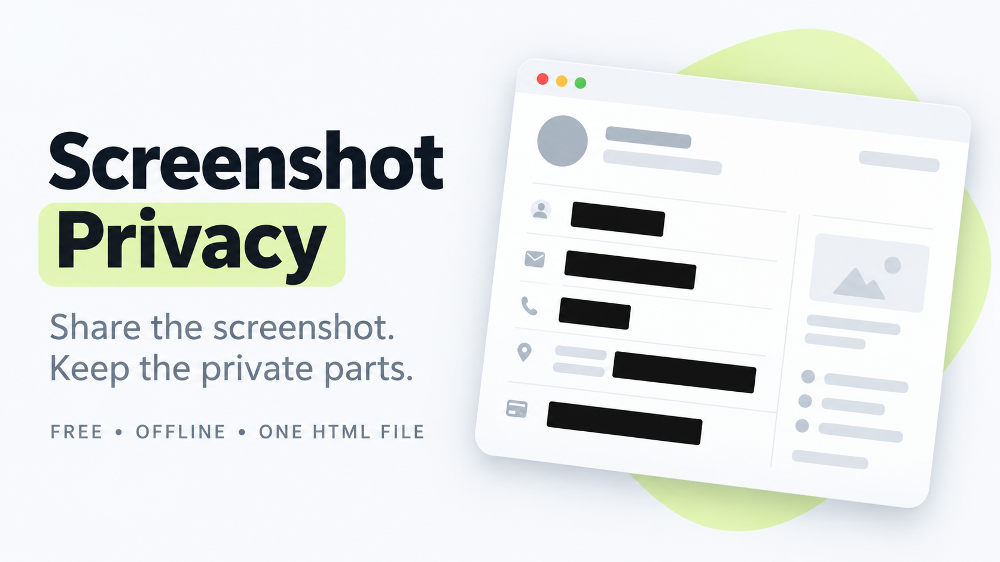

# Screenshot Privacy

**Share the screenshot. Keep the private parts.**

A free, offline screenshot editor in one HTML file. Manually cover private details with solid blocks, review the finished image, and save a flattened PNG.

## Start here

1. Extract the ZIP into a folder on your computer.
2. Open **index.html** in your desktop browser. If it opens in a text editor, use **Open with** and choose your browser.
3. Choose a screenshot, drop one onto the page, or paste an image with Ctrl/⌘ V. You can also try the fictional sample.
4. Drag over private details with **Cover**. Use **Select** to move a cover or resize it using its handles.
5. Click **Review & export**, inspect the finished PNG, then click **Save PNG**.

Only `index.html` is needed to run the app. There is no installation, account, internet requirement, package manager, or build step. The other files are publishing materials.

## Everyday controls

| Control | What it does |
| --- | --- |
| Cover | Draw a fully opaque rectangle |
| Black / White | Choose the selected cover's color, or the color of new covers |
| Extra coverage | Add 0–16 pixels around the cover; default 2 px |
| Select | Move covers and drag their resize handles |
| Add cover | Place a rectangle without dragging; edit its coordinates and size |
| Apply size | Apply X, Y, width, and height in image pixels |
| Crop | Drag around the area to keep, then click Apply crop |
| Pan / zoom | Inspect details; zoom changes the view, not the output resolution |
| Undo / Redo | Undo up to 60 changes, including covers and cropping |
| Review & export | Display the actual flattened PNG before saving |
| Copy image | Copy the finished PNG when the browser permits it |

Keyboard: **B** cover, **V** select, **C** crop, **H** pan, **Ctrl/⌘ Z** undo, **Ctrl/⌘ Shift Z** redo, **Delete** remove selected cover, **Esc** cancel/deselect, **Ctrl/⌘ S** review export. Arrow keys move a selected cover 1 pixel; hold Shift for 10 pixels. Shortcuts do not change covers while you type in the coordinate fields.

Coordinates are relative to the current crop. Covers outside the crop stay in the editing session and can return if you undo the crop. They do not appear in the cropped export. **Clear all** removes covers and can be undone.

## What the exported file contains

The app creates a new PNG and paints solid color over the selected pixels. Covers are flattened into that image; the PNG has no editable cover layers or undo history. It retains the image's pixel dimensions, or the crop's dimensions when cropped. Transparent source areas are flattened onto white.

The export uses a generic `screenshot-private-…png` filename. Original metadata is not copied. Optional PNG metadata chunks are removed from the newly encoded file.

**This is manual redaction.** The app does not automatically find private information. Check the whole image at 100%, including small text, faces, avatars, QR codes, reference numbers, and the edges of covers. Details left outside a cover remain visible. Share the exported PNG, not the original screenshot or a screen capture of the editor.

Your original file stays unchanged. Editing is temporary: there is no app history, project save, or recovery after reloading. Save the finished PNG before closing the tab. Reopening an exported PNG lets you add further covers; it cannot restore painted-over pixels.

## Local use and compatibility

The app makes no network requests. It has no analytics, external fonts, libraries, account, or browser database. Working images and edits are available in the open tab. This is not a secure-erasure tool for your original files, browser, clipboard, or operating system.

Modern desktop Chrome, Edge, Firefox, and Safari are intended targets, with JavaScript enabled. Desktop is the primary workflow. The layout adapts to narrow screens, but mobile file handling varies. **Copy image** depends on browser support, permissions, and context. If it is unavailable, use **Save PNG**. Pasting requires an image in your clipboard; a copied file path or text is not an image.

Limits: one still PNG, JPG, or WebP at a time; up to 30 MB, 20 megapixels, and 16,000 px on either side; up to 100 covers. Animated PNG/WebP, GIF, PDF, HEIC, and SVG are not supported. Large images may be slow on low-memory devices. Output is always PNG; the app does not resize or compress to a target file size.

## Troubleshooting

- **Nothing opens:** extract the ZIP first and open `index.html` in a browser with JavaScript enabled.
- **Review is disabled:** apply or cancel the current crop first.
- **Copy image is unavailable:** use Save PNG.
- **No saved file appears:** check your browser's download panel, save-location prompt, and download permissions. “Download requested” means the browser received the request; the app cannot confirm that it reached your drive.
- **A format is rejected:** use a still PNG, JPG, or WebP within the limits above.
- **An export fails:** your working image stays open. Try a smaller source image; the app does not substitute the unedited original as a fallback.

## Files in this package

| File | Purpose |
| --- | --- |
| `index.html` | Complete app and editable source |
| `README.md` | Use and upload guide |
| `Listing-Copy.txt` | Product description, FAQs, repository copy, and social captions |
| `LICENSE.txt` | MIT license |
| `Images/Banner-Horizontal.png` | Horizontal cover, 1672 × 941 |
| `Images/Banner-Vertical.png` | Vertical promotion, 941 × 1672 |
| `Images/Banner-Square.png` | Square promotion, 1254 × 1254 |
| `Images/Product-Image.png` | Product explainer, 1254 × 1254 |
| `Images/Image-Prompts.txt` | Prompts used for the generated artwork |

The promotional images are conceptual illustrations, not screenshots of the app.

## Upload guide

### Gumroad

1. Create a digital product titled **Screenshot Privacy**.
2. Paste the product description from `Listing-Copy.txt`.
3. Attach `ScreenshotPrivacy-Complete-Package.zip` as the downloadable content.
4. Add the horizontal cover, square thumbnail, and product explainer from `Images`.
5. Set the amount to **$0** and the suggested amount to **$0** if shown. Keep all features in the free download.
6. Check the preview and free download flow, then publish when ready.

Gumroad's free product setup uses **$0+ / pay what you want** for a product without priced versions. Users can enter 0; an optional amount may also be allowed by the platform. Include “Enter 0 to download free.” GitHub also provides a download without a price-entry step.

Source checked 17 October 2026: [Gumroad free product pricing](https://gumroad.com/help/article/133-pay-what-you-want-pricing).

### GitHub

1. Create a repository named `screenshot-privacy`.
2. Use **Add file → Upload files** to upload the contents of this `ScreenshotPrivacy` folder into the repository root. Keep the `Images` folder together with its files.
3. Use the repository description and topics from `Listing-Copy.txt`. This README becomes the project page.
4. Attach the complete ZIP to a release named **v1.0.0** for an easy download.

No build command is needed. A static host can serve `index.html` as-is. The downloaded file is the intended offline version.

Source checked 17 October 2026: [GitHub file upload guide](https://docs.github.com/en/repositories/working-with-files/managing-files/adding-a-file-to-a-repository).

### Other platforms

Upload the ZIP as a free download, use the supplied description, and choose the image format that fits. Keep the manual-redaction and temporary-session notes in your listing.

## Release checks

Version 1.0.0 · 17 October 2026.

11 automated checks passed, using a native canvas renderer and simulated DOM workflows. They covered exported PNG pixels and opacity, cover edges and padding, cropping, metadata stripping, accepted/rejected inputs, failed encoders, undo/redo, pointer cancellation, coordinate validation, file replacement, actual export blobs, and clipboard error handling. The generated fictional sample export was visually inspected. The app has no external dependencies or request/storage APIs.

**Live browser interaction and visual layout testing were unavailable in the build environment.** These checks do not establish cross-browser compatibility. Before a public launch, open `index.html` in your chosen browser, cover a detail in the fictional sample, crop, undo, export, and open the saved PNG to check it. Clipboard and operating-system download behavior still need that browser check.

## Editing and license

All styles, SVG icons, and JavaScript are inline in `index.html`. Open it in a text editor to change the app. Keep the export opaque, flatten the covers before saving, and preserve the export review step when making changes.

MIT - see `LICENSE.txt`. This release is free with all features included.
